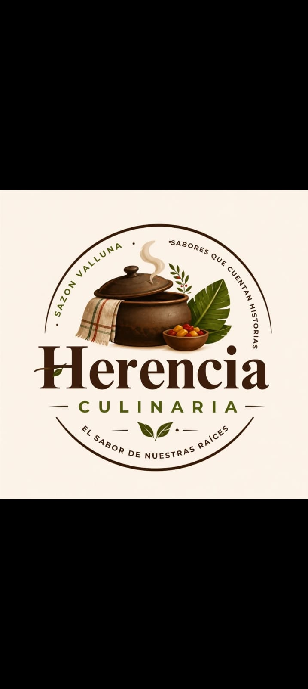

<div align="center">



# Herencia Culinaria

**Tamales vallunos, lechona y dulces con sazón valluna.**
El sabor de nuestras raíces, cocinado en olla grande sobre fogón de leña y listo para tu mesa.

[]()
[]()
[]()
[](https://getbootstrap.com/)
[]()
[]()

</div>

---

## 🍃 ¿Qué es?

**Herencia Culinaria** es un emprendimiento de comida con sazón valluna. Esta es su página web: una vitrina donde cualquiera puede ver la carta, armar su pedido y enviarlo **directo por WhatsApp**, sin intermediarios, sin crear cuentas y sin formularios largos.

No hace falta saber de tecnología para usarla: se toca lo que se antoja, se revisa el pedido y se envía.

---

## 🍽️ Lo que se cocina en la casa

| Plato | Detalle | Precio |
|---|---|---|
| 🫔 **Tamal de cerdo** | Tamal valluno envuelto en hoja de plátano | $16.000 |
| 🫔 **Tamal mixto** | Cocinado en olla sobre fogón de leña | $16.000 |
| 🎁 **Atado de 2 tamales** *(promoción)* | De cerdo o mixtos. Ahorras $2.000 frente a pedirlos sueltos | $30.000 |
| 🐖 **Lechona** | Con sazón valluna, lista para tu mesa | $35.000 |
| 🍚 **Arroz con leche** | Cremoso y con canela, vaso de 12 oz | $8.000 |
| 🥥 **Crema de arrechón del Pacífico** | Crema tradicional hecha con coco y especias, botella | $25.000 |
| 🎄 **Natilla navideña** | Próximamente. Se puede reservar | — |

> 💬 Precios vigentes al momento de escribir este documento; la fuente de verdad es siempre la página. Los pedidos se hacen **por encargo**, así que se recomienda pedir con anticipación.

---

## 🛒 Cómo pedir (3 pasos)

1. **Elige tus antojos.** Toca los productos de la carta para sumarlos.
2. **Revisa tu pedido.** Ajusta cantidades e indica dónde y para cuándo lo necesitas.
3. **Envíalo por WhatsApp.** Se abre el chat con el mensaje ya escrito. Solo lo envías y te confirmamos.

> Tu pedido se va guardando en tu propio navegador, así que si cierras la página sin querer, no pierdes lo que habías armado.

---

## ✨ Qué hace especial a la página

- 🔥 **Entrada ambientada:** un portal inicial, *"Entrar a la cocina"*, con sonido opcional de cocina.
- 📖 **Carta con filtros** por categoría: Todo, Tamales, Platos, Dulces y Cremas.
- 🧺 **Pedido armado en la propia página**, con mensaje de WhatsApp generado automáticamente.
- 🏷️ **Promoción y novedades** destacadas: el atado de tamales, la natilla de Navidad y la crema del Pacífico.
- 🔊 **Sonido de clic** que se puede silenciar con un botón.
- 📱 **Pensada para el celular**: la mayoría de los pedidos llegan desde ahí.
- 📤 **Compartir por WhatsApp** la página con tus conocidos.
- ⚡ **Rápida y ligera:** sitio estático, tipografías locales e imágenes cargadas bajo demanda.
- ♿ **Cuidada en accesibilidad:** navegación con teclado (`Esc` cierra menús y portal) y botones con etiquetas descriptivas.

---

## 🛠️ Tecnologías

| Tecnología | Para qué |
|---|---|
| HTML5 | Estructura de la página |
| CSS3 | Diseño propio, adaptable a cualquier pantalla |
| JavaScript (sin frameworks) | Carta, pedido, sonido, animaciones y mensaje de WhatsApp |
| Bootstrap Icons | Iconografía |
| `localStorage` | Recordar el pedido y la preferencia de sonido |
| `IntersectionObserver` | Animaciones suaves al hacer scroll |
| WhatsApp (`wa.me`) | Canal de pedidos |

Es un **sitio 100 % estático**: no necesita servidor, base de datos ni instalación.

---

## 🚀 Verlo en tu computador

```bash
git clone https://github.com/Sergio-Bustos/Herencia-Culinaria
cd Herencia-Culinaria
```

Después, abre `index.html` con doble clic. Si prefieres un servidor local:

```bash
python -m http.server 8000
# y visita http://localhost:8000
```

---

## ✏️ Cómo actualizar la carta

| Quiero cambiar... | Dónde |
|---|---|
| Textos, productos y precios de la carta | `index.html` |
| Número de WhatsApp | `index.html` (enlaces `wa.me`) y `script.js` (constante del teléfono) |
| Colores, tipografía y diseño | `styles.css` |
| Fotos | Reemplaza los `.jpg` conservando el mismo nombre |

---

## 📁 Estructura

```
Herencia-Culinaria/
├── index.html        # Toda la página: portal, carta, promo, novedades, nosotros, contacto
├── styles.css        # Diseño
├── script.js         # Pedido, filtros, sonido, animaciones
├── *.jpg / *.png     # Fotos de productos, pósters, logo y favicon
├── *.wav             # Sonido de clic y de cocina
└── font_*.woff2      # Tipografías incluidas (funciona sin conexión a Google Fonts)
```

---

<div align="center">

Hecho con cariño y sazón por **[Sergio Bustos](https://github.com/Sergio-Bustos)**
*Del fogón a tu mesa.* 🫔

</div>
